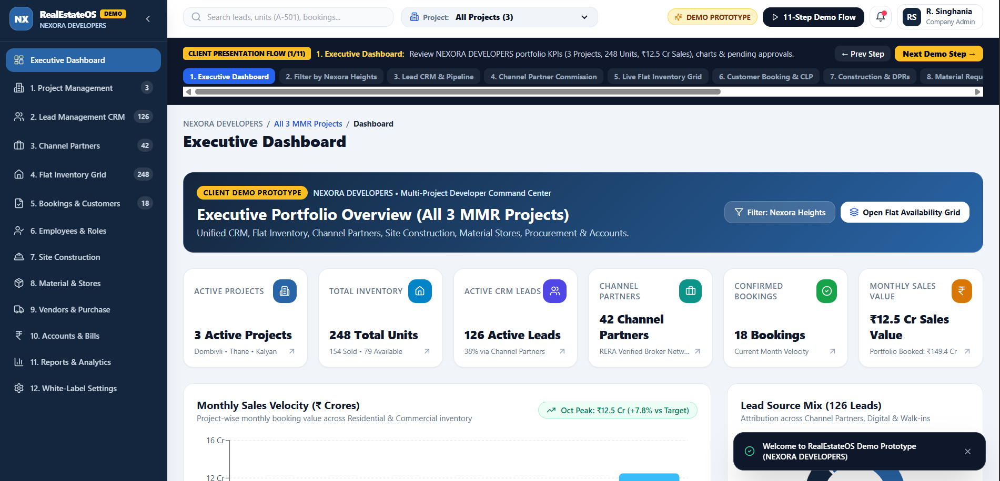

# RealEstateOS — White-Label Real Estate Developer CRM + ERP (Client Demo Prototype)



**Demo Tenant:** `NEXORA DEVELOPERS`  
**Projects Included:**
1. **Nexora Heights** — Dombivli East — Residential — 96 Units (`RERA: P51700099101 [DEMO]`)
2. **Nexora Skyview** — Thane — Residential — 88 Units (`RERA: P51700099202 [DEMO]`)
3. **Nexora Business Park** — Kalyan — Commercial — 64 Units (`RERA: P51700099303 [DEMO]`)

## Quick Start Guide (For Non-Technical Founders)

1. Install **Node.js (LTS v18 or v20)** from `https://nodejs.org`.
2. Open your terminal inside this folder and run:
   ```bash
   npm install
   npm run dev
   ```
3. Open `http://localhost:3000` in your browser.
